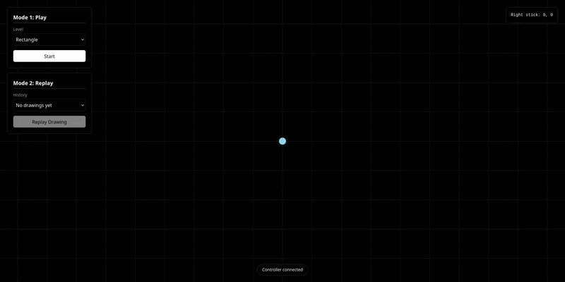

# Smart Drone Controller System (SDCS)
<div align="center">

</div>

## Overview

**Smart Drone Controller System (SDCS)** is a system that lets a user draw on
a web page using a drone controller. The controller is connected with Arduino,
and the drone's movement is translated into drawing on the UI interface.


## Project Structure

```
index.html            # UI: control panel, joystick panel, status bar, canvas
js/arduino.js         # Connects to the USB controller and reads the stick values
js/drawing.js         # Moves the drone and draws everything on the canvas
js/gameLogic.js       # Game states, timer, start/finish flow, and result display
js/match_logic.js     # Compares the drawing with the chosen shape and returns a score
```

## Tools used

| Name | Description |
| :---: | :--- |
| `Arduino` | We use an Arduino to read input signals from the physical drone controller. |
| `Gemini API` | We use Google's Gemini API to compare the user's drawing with the requested shape and return a similarity score. |
| `JavaScript` | We use JavaScript to handle the logic drawing on the web page. |
| `HTML` | We use HTML to build the web page. |
| `CSS` | We use CSS to style the web page and the drawing interface. |
| `Tailwind` | We use Tailwind CSS to design and style the UI quickly and responsively. |

## Game Logic (`gameLogic.js`)

Controls the full game flow, from connecting the controller to showing the final result.

- The user connects the USB controller, then chooses a level (Rectangle, Circle, or Triangle).
- When the round starts, the drone returns to the center and a 15-second timer begins while the user draws with the controller.
- When the time ends, the drawing is sent to be checked against the chosen shape, and the game receives a score and feedback.
- A score of 80% or more shows **SUCCESS**, otherwise **FAILED**, and the user can click **Play Again** to retry.

For more information, [click here](docs/game.md).